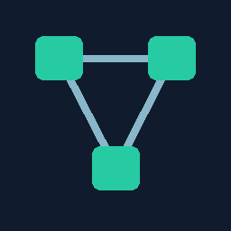

# System Design

**You reason. The tutor challenges.**

An early Cursor plugin for learning system design through scenarios, tradeoffs and failure cases. The tutor asks for your reasoning before explaining the answer. When a gap appears, it teaches the concept, draws a small diagram and gives you one thing to read. Then you explain it back in your own words.

For anyone learning how systems work: someone designing their first backend, a developer moving beyond a single server, or an experienced engineer revisiting an unfamiliar topic. The goal is understanding you can use in a new problem, not a collection of interview answers.

## Get started

You need [Cursor](https://cursor.com) with local plugin support and [Python 3](https://www.python.org/downloads/). The session-start hook uses Python to restore learning context. No extra Python packages are needed. Check that `python3 --version` works in your terminal; Python is not included on every machine.

Install from the repository ZIP, or clone it using the commands below. This is an early alpha; the actual Cursor smoke test is still pending.

1. Extract the ZIP to get the `system-design` folder.
2. Create the local plugin directory in your terminal:

   ```sh
   mkdir -p ~/.cursor/plugins/local
   ```

3. Copy the entire `system-design` folder into that directory. Its manifest should be at:

   ```text
   ~/.cursor/plugins/local/system-design/.cursor-plugin/plugin.json
   ```

4. In Cursor's command palette, run **Developer: Reload Window**.
5. Open a separate folder for studying. Start an Agent chat with access to local files, then run:

   ```text
   /sd-learn
   ```

Setup asks how long you have, then a simple question about using a website. You can answer in plain words, make a guess or say "I don't know." The tutor builds the curriculum and chooses where to begin. It never expects you to know the syllabus or name your weak points. You do not need a project, a running database or any system-design knowledge.

To install from GitHub:

```sh
git clone https://github.com/denelbjohn18/system-design.git system-design
mkdir -p ~/.cursor/plugins/local
cp -R system-design ~/.cursor/plugins/local/
```

Use a directory without an existing `system-design` folder. If the plugin is already installed, back it up before replacing it. Then reload Cursor and run `/sd-learn`.

If the skill does not appear, check Customize and the folder nesting. Do not put one `system-design` folder inside another. Installation still needs to be verified in your Cursor version; the package checks alone do not prove it loads.

## What it feels like

You open a study folder, run `/sd-learn` and sit down for your first lesson. You have never studied system design.

This is an illustrative conversation, not a fixed script.

**Tutor:**

```text
How long would you like to study today?
```

**You:**

```text
An hour. I don't know anything about system design.
```

**Tutor:**

```text
You don't need to choose topics. We'll start with what happens when you
use a website, then build up to how systems store data and handle more people.

When you type a website address and a page appears, what do you think
happened in between? A guess or "I don't know" is fine.
```

**You:**

```text
I don't know. The browser somehow gets the page?
```

**Tutor:**

```text
Your browser asks another computer for the page. That computer is a server.
It receives a request and sends a response back.

browser -> request -> server
browser <- response <- server

If the server can't reply, what might you see?
```

**You:**

```text
The page might keep loading, or show an error.
```

**Tutor:**

```text
Yes. A page depends on both a request reaching the server and a response
getting back. That's one reason a website can fail even if your browser works.

You save a note in an app, close it and return tomorrow. What needs to
be kept so the note is still there?
```

From everyday answers like these, the tutor finds the next small step. It does not ask you to rate your knowledge of caching, CAP or sharding before you know what those words mean.

Later, when you understand requests and stored data, a lesson might ask why repeatedly opening a product page puts work on a database. You propose reusing a saved result. The tutor changes the price and asks whether the saved copy is still right. That is where caching and freshness enter the lesson, not in an opening vocabulary test.

After an explanation, you get an explain-back question:

```text
In your own words, what does the browser ask for, who answers,
and what can go wrong before the page appears?
```

The next question changes the situation. Can you explain why an app might show a loading indicator when a request has not received a response yet? The tutor checks your reasoning, not whether you repeat its wording.

You can answer in plain English. Ask for a hint, a smaller question or a clearer explanation. A hint helps you learn, but an assisted answer is not recorded as an independent pass.

| Step | What happens |
| --- | --- |
| Scenario | Work through a concrete problem with explicit constraints. |
| Challenge | Test your assumptions with a changed condition or failure. |
| Explanation | Learn the concept once the gap is clear. |
| Explain-back | Describe the mechanism, tradeoff and failure behavior yourself. |
| Transfer | Apply the idea to a different problem. |

Intro lessons check a correct explanation and a simple application. Later design lessons check the mechanism, tradeoffs, failure reasoning and transfer. A first independent pass is provisional. A fresh independent recall at least 24 hours later can earn retained status. Reading something or recognizing the answer does not count as mastery.

A topic can take several sessions. You can continue into a related topic while an earlier one awaits review; depth-first does not mean waiting around for a review date.

For a longer walkthrough, see [your first study session](docs/first-day.md).

## Make it yours

Your experience determines the size of the questions and how much support you get. Everyone still has to reason.

| Starting point | How the tutor adapts |
| --- | --- |
| New to system design | Smaller problems, plain words and short prerequisite lessons. |
| Some backend experience | More attention to interactions, workload and tradeoffs. |
| Comfortable with the basics | Harder failures, counterexamples and changed constraints. |

The full curriculum is built upfront, using the [System Design Roadmap](https://roadmap.sh/system-design?fl=1) as a reference. It starts with requests, responses and stored data. Then come performance and scale, DNS and content delivery, load balancing, databases, replication, sharding, caching, background work and queues, consistency/CAP, reliability, monitoring, security and design patterns, and integrated cases.

The sequence adds beginner foundations and brings communication forward before distributed-system ideas. You do not choose a topic from a list of unfamiliar names. The tutor walks through the map in order, adapting question size and depth from your reasoning. Later pattern families get an overview before selected deeper practice; an overview is not recorded as mastery.

Tell the tutor what you need:

- "Give me a smaller question."
- "Help me trace one request."
- "I want to go deeper into replication."
- "Skip this for now." It stays incomplete.
- "Stop and save." Resume the checkpoint later.
- "Pause learning." Resume with `/sd-learn`.

Use `/sd-review` for saved weak points that are due for recall. It asks one question at a time, tests a changed scenario and adjusts the next review date. Reviews use 1, 3, 7, 14 and 30-day intervals after independent passes, staying at 30 days after that. Assisted answers and misses get next-day repair too. Default one review per session, at most three, so a backlog does not swallow the lesson. Same-day practice does not postpone recall. No background reminders are sent.

Your profile, curriculum and evidence live in `.system-design/` inside the study workspace:

```text
.system-design/
  state.json       # Validated source of truth
  profile.md       # Readable view
  curriculum.md    # Readable view
  progress.md      # Recent evidence view
  backups/         # Previous saved revisions
```

A small local Python helper saves the canonical JSON under a write lock, checks revision conflicts and backs up the previous state. The Markdown files are generated views, not the place to edit scores. Atomic replacement protects the JSON; if a crash leaves a stale view, it can be regenerated without inventing progress. The helper validates evidence structure, not whether the model graded correctly.

State is bound to the selected study folder; it never borrows a parent folder's notes. Use one active chat per study folder on a local trusted filesystem. Multi-root windows require a folder choice in the explicit skill. The session-start hook restores validated active state; `/sd-learn` is the reliable manual restore path. Restoration errors are reported rather than silently discarding progress. Neither a restart nor another invocation resets history. Keep notes out of Git if you do not want to share them; the tutor will not silently change your workspace's ignore file.

Old Markdown-only state is not migrated automatically. Keep it intact and choose a fresh study folder or review a migration deliberately. Conflicting revisions, locks, malformed files or unsafe links stop writes; the tutor must say when something was not saved. Do not delete a lock or restore a backup without checking it. Backups grow with use; the current canonical-state limit is 2 MB, with an error rather than silent history deletion.

The plugin has no backend, extra account or telemetry. Your saved notes do enter Cursor's model context during lessons, so Cursor's data settings apply. Do not put secrets or private company details in them.

This is an early, prompt-based tutor. Teaching and grading depend on the model and can be wrong. The log records learning attempts, not independently verified study time or a certification. Optional experiments stay local unless you explicitly choose otherwise.

## Updating

Local installs do not update automatically. Back up the installed plugin, replace it with the new release and run **Developer: Reload Window**. Keep your study workspace separate from the installation folder so replacing the plugin does not replace your notes.

There is no automatic update channel. This public alpha is `0.1.1-alpha.1`; it has not been smoke-tested in Cursor. JSON/state/hook tests do not prove teaching quality or compatibility.

## Development

Run the package checks from the plugin root:

```sh
python3 -m unittest discover -s tests -v
python3 -m json.tool .cursor-plugin/plugin.json
python3 -m json.tool hooks/hooks.json
```

These check state safety, deterministic schedules, hook behavior and JSON files. Load the plugin in Cursor to verify skill discovery and live behavior.

## License

[MIT](LICENSE). Use, change and redistribute the software under its license terms. Preserve the license notice when distributing copies. No warranty is provided.
